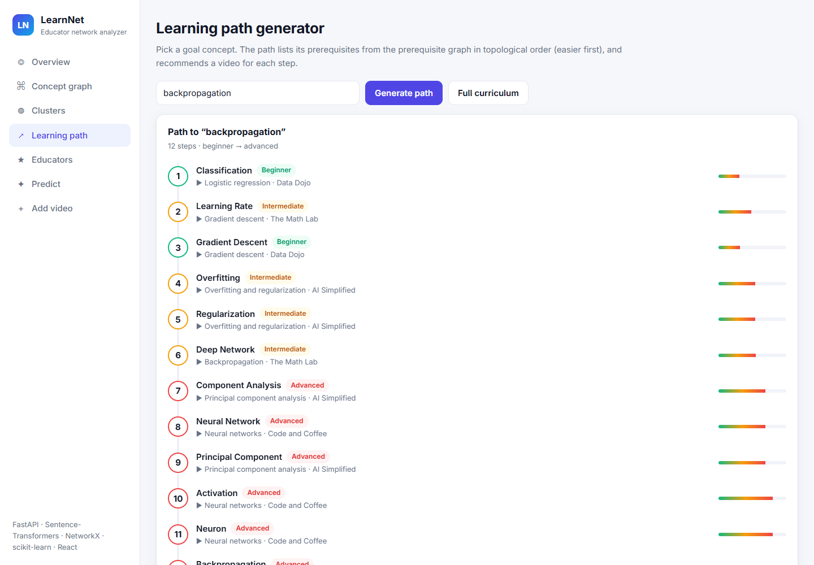
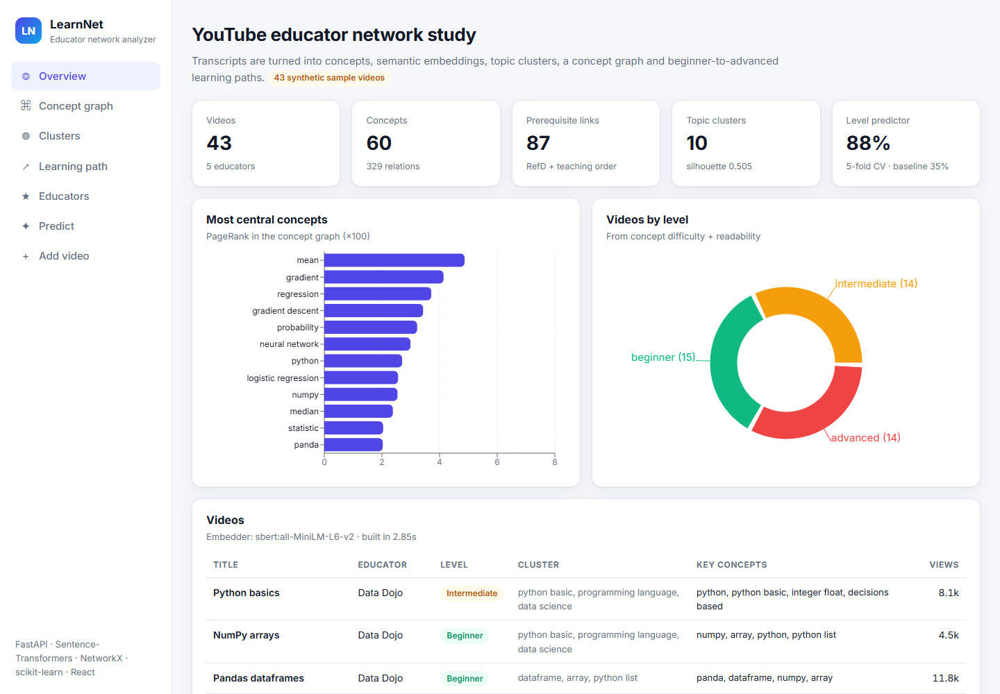
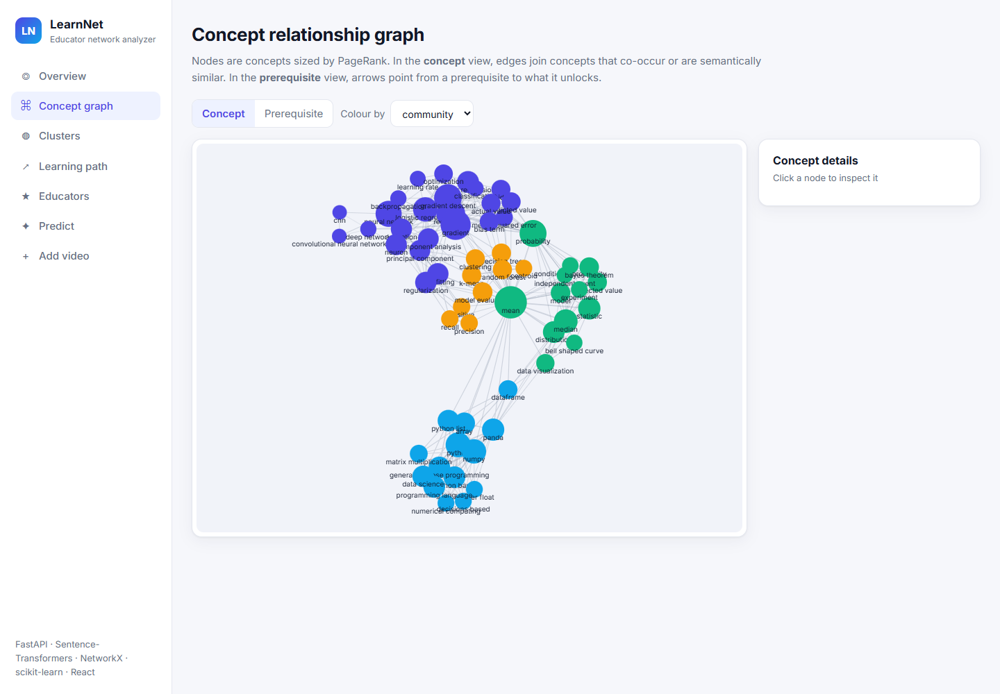
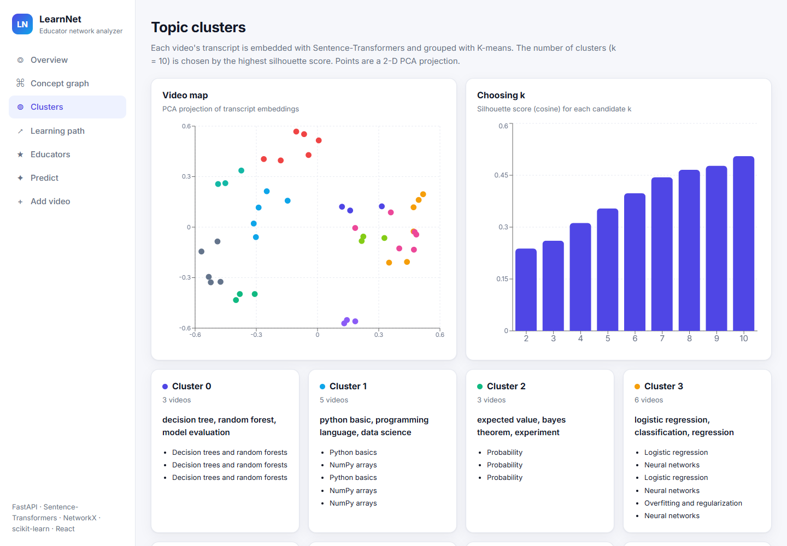
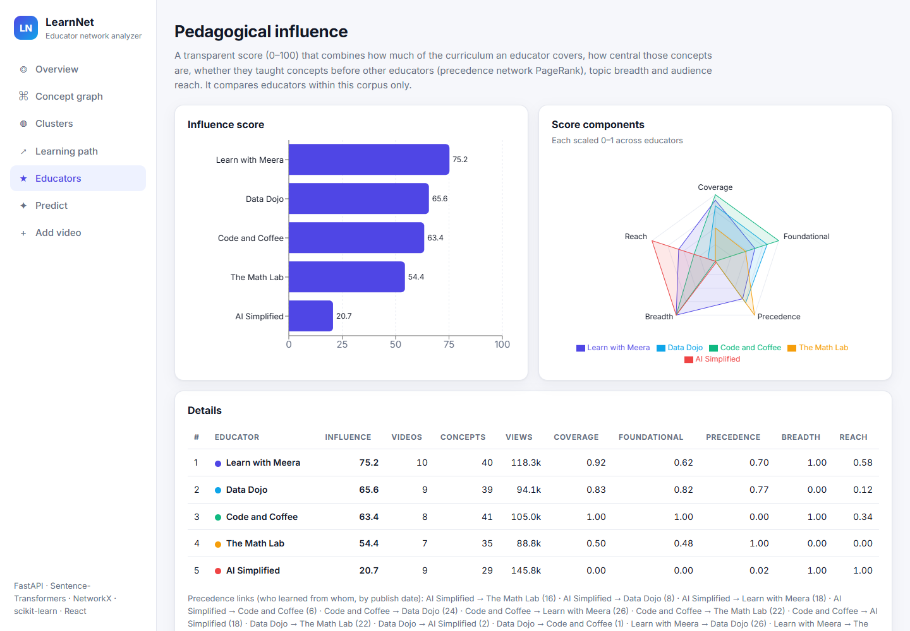
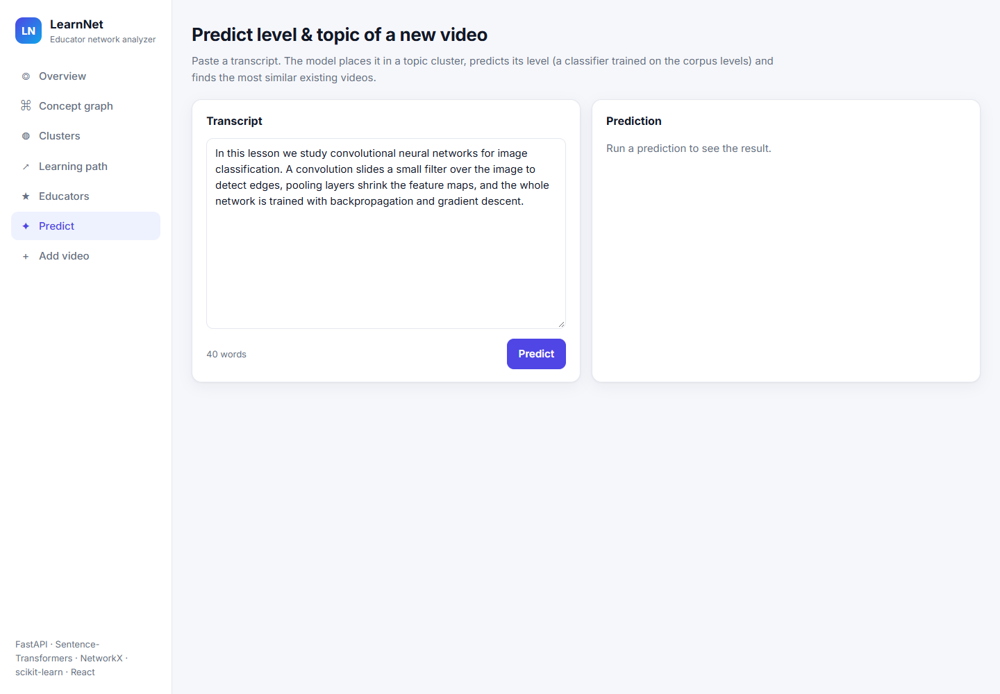
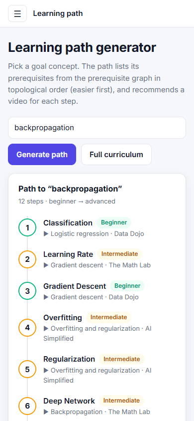

# LearnNet Analyzer — YouTube Educator Network Study & Prediction

LearnNet turns educational YouTube transcripts into a **knowledge network**. It extracts the concepts each video teaches, embeds transcripts semantically, clusters videos into topics, builds concept-relationship and prerequisite graphs, generates **beginner → advanced learning paths**, scores the **pedagogical influence** of each educator, and **predicts** the level and topic of new videos. A FastAPI backend serves an interactive React dashboard.

**Tech stack:** Python 3.11 · NLP · Sentence-Transformers (`all-MiniLM-L6-v2`) · scikit-learn · NetworkX · FastAPI · React 18 + Vite · Recharts · react-force-graph



## Features

| Feature | Implementation |
|---|---|
| Transcript processing | Clean captions (noise tags, timestamps, filler words). Fetch captions from a YouTube URL with `youtube-transcript-api`, or paste text. |
| Concept extraction | 1–3-word key-phrases (no stopwords or verbs, no crossing sentence boundaries), ranked by corpus TF-IDF and re-ranked by semantic closeness to the corpus (KeyBERT-style) |
| Semantic embeddings | Sentence-Transformers on CPU. Offline TF-IDF + SVD (LSA) fallback. |
| Text clustering | K-means on transcript embeddings, with k chosen by cosine silhouette score; PCA map |
| Concept graph | NetworkX: co-occurrence + embedding-similarity edges, PageRank centrality, modularity communities |
| Prerequisite graph | **RefD** (reference distance, Liang et al. 2015) plus each educator's teaching order; made acyclic, then transitively reduced |
| Learning paths | Ancestors of a goal concept in topological order (easier first), with a recommended video for each step |
| Pedagogical influence | Coverage, foundational centrality, *precedence-network PageRank* (who taught a concept first), breadth and reach |
| Prediction | Logistic-regression level classifier (cross-validated at build time), nearest-centroid topic cluster and similar videos for a new transcript |
| Dashboard | 7 pages: Overview, Concept graph, Clusters, Learning path, Educators, Predict, Add video. Responsive, light and dark themes |

## Data

`backend/data/sample_corpus.json` is a **synthetic** corpus of 43 transcripts from 5 **fictional** educators covering 18 machine-learning topics. It is generated by `backend/scripts/make_sample_corpus.py` and contains no real YouTube content. Add real videos from the **Add video** page or `POST /api/videos`; they are stored in `backend/data/user_videos.json` (git-ignored).

## Project structure

```
learnnet-analyzer/
├── backend/
│   ├── learnnet/            # analysis library
│   │   ├── transcripts.py   # load / clean / fetch YouTube captions
│   │   ├── concepts.py      # key-phrase extraction
│   │   ├── embeddings.py    # Sentence-Transformers + TF-IDF/SVD fallback
│   │   ├── clustering.py    # K-means + silhouette + PCA
│   │   ├── graph.py         # concept graph + RefD prerequisite DAG
│   │   ├── difficulty.py    # concept / video difficulty, levels
│   │   ├── learning_path.py # goal matching + topological paths
│   │   ├── influence.py     # educator influence scoring
│   │   ├── prediction.py    # level classifier
│   │   └── analyzer.py      # orchestrates everything, API views
│   ├── api/main.py          # FastAPI app (also serves frontend/dist)
│   ├── scripts/make_sample_corpus.py
│   ├── data/sample_corpus.json
│   ├── tests/               # pytest (26 tests)
│   └── requirements.txt
├── frontend/                # React + Vite dashboard
│   ├── src/pages/*.jsx, src/components/ui.jsx, src/api.js, src/utils.js (+ utils.test.js)
│   └── package.json
├── docs/ARCHITECTURE.md, docs/screenshots/
├── run.ps1, run.sh, .env.example
```

## Installation

Requirements: Python 3.11 and Node.js 18+.

```bash
git clone https://github.com/manisha2001-20/learnnet-analyzer.git
cd learnnet-analyzer/backend
python -m venv .venv
# Windows: .venv\Scripts\activate      macOS/Linux: source .venv/bin/activate
pip install torch --index-url https://download.pytorch.org/whl/cpu   # optional: CPU-only PyTorch (smaller)
pip install -r requirements.txt

cd ../frontend
npm install
```

The first start downloads the `all-MiniLM-L6-v2` model (~90 MB). Set `EMBEDDING_BACKEND=tfidf` to run fully offline.

## Running

**Development (two terminals, hot reload):**

```bash
# terminal 1
cd backend && uvicorn api.main:app --reload --port 8000
# terminal 2
cd frontend && npm run dev          # http://localhost:5173 (proxies /api to :8000)
```

**Single server:** `npm run build` in `frontend/`, then run the backend. FastAPI serves the dashboard at http://localhost:8000. Or use `./run.ps1` (Windows) or `./run.sh`.

The API docs are at http://localhost:8000/docs.

| Method | Endpoint | Purpose |
|---|---|---|
| GET | `/api/summary` | Corpus statistics, embedder, clustering quality, predictor CV accuracy |
| GET | `/api/videos`, `/api/concepts`, `/api/clusters`, `/api/educators` | Analysis tables |
| GET | `/api/graph?kind=concept\|prerequisite` | Nodes and links for graph views |
| GET | `/api/learning-path?goal=backpropagation` | Ordered path (omit `goal` for the full curriculum) |
| POST | `/api/predict` `{"text": "..."}` | Level, cluster, concepts and similar videos |
| POST | `/api/videos` | Add a video (transcript or YouTube URL) and rebuild |

## Tests

```bash
cd backend && pytest          # 26 tests: cleaning, URL parsing, concepts, DAG validity, paths, clustering, scores, API
cd frontend && npm test       # 4 Vitest unit tests for UI utilities
```

Backend tests use the offline TF-IDF embedder, so they need no model download.

## Results on the synthetic corpus

Measured on the author's machine with `all-MiniLM-L6-v2`:
- 60 concepts and 10 clusters (silhouette 0.505).
- The prerequisite DAG has 87 edges.
- The level classifier's 5-fold CV accuracy is 0.88, against a majority baseline of 0.35. The level labels come from the same pipeline's difficulty heuristic, so this shows the classifier can *reproduce* those labels for new text. It is not a validated measure of real pedagogical difficulty.
- The dashboard always shows live numbers.

## Screenshots

| Overview | Concept graph | Clusters |
|---|---|---|
|  |  |  |
| **Educators** | **Predict** | **Mobile** |
|  |  |  |

To retake them: run the app, open each page (`/#/overview`, `/#/graph`, …) and use your browser's screenshot tool.

## Limitations

- Difficulty, prerequisites and influence are **transparent heuristics**. They are useful for comparison within one corpus but have not been validated against expert judgements.
- Concept extraction is rule-based (no POS tagger), so some phrases may be imperfect.
- YouTube caption fetching depends on the video having captions and on YouTube's availability.

See [docs/ARCHITECTURE.md](docs/ARCHITECTURE.md) for the formulas and design decisions.
